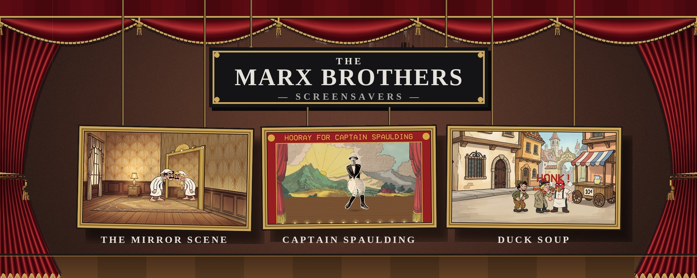

# Marx Brothers screensavers

Screensavers after the Marx Brothers' films, for Linux, Windows and macOS. Each is
its own small program with its own installers: an `.rpm` for Fedora and Nobara, a
`.deb` for Debian, Ubuntu and Mint, a Windows setup program that adds it to Screen
Saver Settings, and for the Mac a screen saver module and an app.

They are unofficial homages, not connected with the Marx Brothers' estate or the
studios.

## [The Mirror Scene](https://github.com/mottipython/mirror-scene)

The broken-mirror gag from *Duck Soup* (1933), in cartoon: a man in a nightshirt
creeps up to an empty mirror frame, and the man on the other side copies everything
he does, almost. Ducks, spins, a dropped hat, a honk, and a third man walking
through the frame.

| | |
|---|---|
|  |  |
| A sudden turn; the reflection is a little slow | He steps away, and the reflection is gone too |
|  |  |
| A dropped hat, and two picked up | A giveaway |

[Download](https://github.com/mottipython/mirror-scene/releases/latest) · [About it](https://github.com/mottipython/mirror-scene#readme)

## [Hooray for Captain Spaulding](https://github.com/mottipython/captain-spaulding)

The African explorer from *Animal Crackers* (1930), cut out of the film's publicity
photograph as a jointed paper doll with brass split pins, dancing on a Victorian
toy-theatre stage to the song from the film, legs going right round their pins. The
film, the photograph and the 1850s scenery are all in the US public domain.

| | |
|---|---|
|  |  |
| Let down on a string | "Hello, I must be going" |

[Download](https://github.com/mottipython/captain-spaulding/releases/latest) · [About it](https://github.com/mottipython/captain-spaulding#readme)

## On Windows, step by step

For Windows 10 or 11. Each screen saver is one download.

1. Click the one you want:
   - [**Download The Mirror Scene**](https://github.com/mottipython/mirror-scene/releases/latest/download/MirrorScene-Setup-0.1.0.exe)
   - [**Download Hooray for Captain Spaulding**](https://github.com/mottipython/captain-spaulding/releases/latest/download/CaptainSpaulding-Setup-0.1.0.exe)
2. If the browser says the file "isn't commonly downloaded" or "could harm your
   device", click the **⋯** (or **^**) beside it and choose **Keep**, then **Keep
   anyway**.
3. Open the downloaded file (click it at the top or bottom of the browser, or find
   it in the **Downloads** folder).
4. A blue box may say **"Windows protected your PC"**. Click **More info**, then
   **Run anyway**. (It says this because the program isn't signed with a paid
   certificate, not because anything is wrong with it.)
5. Windows asks **"Do you want to allow this app to make changes?"** Click **Yes**.
6. Click **Next**, then **Install**, then **Finish**. The Screen Saver Settings open
   with the new screen saver already chosen. Click **OK**.

That's it: it comes on by itself when the computer has been left alone. To pick a
different one later, type **screen saver** in the Start menu search and open
**Change screen saver**. To remove one, open **Settings**, **Apps**, find it in the
list and choose **Uninstall**.

## On the Mac

The quickest way to install them is to paste this into Terminal. It installs every
screen saver module for your user (no password needed):

    curl -fsSL https://raw.githubusercontent.com/mottipython/marx-screensavers/main/tools/mac-install.sh | sh

It opens the Screen Saver settings when it has finished; they are at the end of the
list. To install only some, name them (`mirror-scene`, `captain-spaulding`), and to take them off again:

    curl -fsSL https://raw.githubusercontent.com/mottipython/marx-screensavers/main/tools/mac-install.sh | sh -s -- --uninstall

Every release also has the two Mac files to download by hand, for Apple Silicon and
Intel, macOS 11 or later: the screen saver module (`-mac-screensaver.zip`; unzip and
double-click the `.saver` file) and an ordinary full-screen app (`-mac.zip`). They
are not signed with an Apple developer certificate, so when downloaded in a browser
macOS refuses them at first: allow them under System Settings, Privacy & Security.
The command above avoids that. `tools/mac-test.sh` tries every one in turn and
writes a report.

## On Linux

If [screensaver-service](https://github.com/mottipython/screensaver-service) is
installed, each one appears in its list of screen savers. Without it, each package
starts its own small idle watcher at login on Wayland desktops (see each one's
README).

## Licence

Every project here is MIT.
